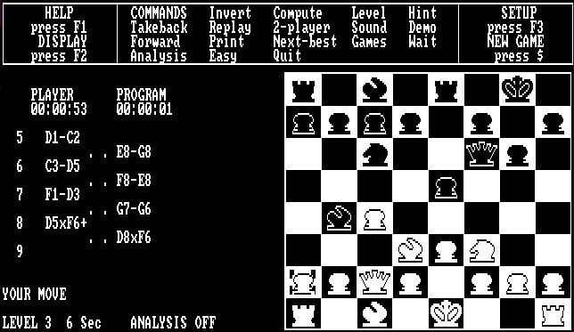

# Psion Chess as a UCI engine

  

Psion Chess (Richard Lang, 1985) was one of the strongest chess programs
of its time. This project runs the MS-DOS version in
a stripped-down, headless DOSBox and adds an adapter that speaks the UCI
protocol, so that it can be used from any chess GUI or match runner.

The adapter does not modify the chess program. It reads the game from the
emulated machine's memory and plays moves by pressing keys, as a user would.

Psion Chess is playing at Lichess as
[psion-chess](https://lichess.org/@/psion-chess). Feel free to
[challenge](https://lichess.org/?user=psion-chess#friend) it
(no account needed).

## Running

### Quick start

Download and unpack the latest [release package](https://github.com/vdbergh/psion-chess/releases/latest) for your OS and point your GUI to the `psion` executable it contains.

*Note:* The macOS binary is unsigned. This means that you may need to run

    xattr -dr com.apple.quarantine psion-chess-macos-arm64

once in the directory where you unpacked the package to get it to run. A self compiled binary is not affected by this restriction. See [Building](#building).

### Command line options

- `-d`, `--download`: download and verify Psion Chess and
install its files in a directory where the adapter can find them (see
  [data/README.md](data/README.md)). Needs `curl`, which Linux, macOS and
  Windows 10+ normally have.
- `-c N`, `--cycles N`: run the emulated PC at a fixed speed of N
  instructions per millisecond (see
  [Speed](#speed)), e.g. `-c 300` to emulate the original IBM PC.
  Equivalent to setting the `Cycles` UCI option.
- `-V`, `--verbose`: augment the UCI output with lots of diagnostics
   written to stderr. Equivalent to issuing the UCI command `debug on`.
- `--tm-options`: expose the time management UCI options described in
  [docs/time-management.md](docs/time-management.md).
- `-v`, `--version`: print the version of the adapter.
- `-h`, `--help`: list these options and exit.

### Supported UCI commands

`uci`, `isready`, `ucinewgame`, `position startpos|fen ... [moves ...]`, `go`
`wtime`, `btime`, `winc`, `binc`, `movestogo`, `movetime`, `depth`,
`nodes`, `mate`, `infinite`, `ponder` (the first limit reached ends the
search), `ponderhit`, `stop`,
`setoption`, `debug on|off` and `quit`.
How the engine handles the gray areas of the protocol is described under
[Quirks](docs/implementation.md#quirks).

### UCI options

- `Ponder`: for GUIs that only let an engine ponder if it offers it.
- `Move Overhead` (ms, default 10): the estimated _average_ time between
the moment that the adapter tells Psion to stop searching and
the moment that the opponent actually sees the move via the GUI
or the network.
  The default
  of 10 ms is the engine's own overhead on an unloaded i5-1135G7.
  Increase `Move Overhead` if the engine loses on time, for
  example when playing fast games over a slow network or on a busy
  machine.
- `Clock Buffer` (ms, default 100): the adapter tries
to leave at least this much time on the clock after every search. This is
only a protection against exceptional events such as an occasional dropout on a busy machine. Systemic overhead should be
taken care of by `Move Overhead`.
- `Cycles` (default `highest`): the number of instructions per
  millisecond (capped at 1,000,000) of the emulated PC (see
  [Speed](#speed)).
   Values above what the host is capable of, as well as
   the special value "`highest`,
  result in maximum emulator speed. The `Cycles` option applies only while Psion searches:
  other actions such as setting up the position and entering moves
  are executed at full speed.
- `UCI_LimitStrength` (default false) and `UCI_Elo` (1150 to 1650,
  default 1400): play at a given strength on the CCRL Blitz scale, by
  running the emulated PC at reduced speed. This overrides `Cycles`.
  The scale was calibrated at the CCRL blitz time control 2'+1".
  A host that is too slow for the requested speed will play weaker.

### Limitations

- Chess960 is not supported.
- `go searchmoves` is ignored.
- Psion's depths are odd numbers: `go depth 6` searches to depth 7.
  Psion ends its search as soon as it
  has found a mate, so `go mate 2` can also give a mate in 3.
- Psion's  level *Infinite* could not be used since it has a bug that causes
  Psion to lock up once its search reaches the maximum depth,
  which happens for example in locked pawn endings. Hence the adapter sets Psion
  to level 11 (4 minutes per moves) which implies that longer `movetime` searches end before
  the requested time.
- The move counters of a FEN are ignored, so Psion's 50-move rule counts
  from the FEN (the GUI should still apply the correct rule itself).
- Psion searches a position set up from a FEN differently from the same
  position reached by playing moves (the piece lists are ordered differently,
  which influences move generation order; see
  [docs/search-internals.md](docs/search-internals.md#piece-indices-after-a-fen)).
  So it may generate different info lines and choose another move.
- Limitations of `info` lines:
  - The node count is obtained by counting Psion's board writes
    (see [docs/search-internals.md](docs/search-internals.md)); it is
    within 0.5% of the true value.
  - Psion truncates the principal variation to 8 moves.
  - Psion's score has a resolution of about 4 centipawns.
- Psion does not use its opening book after a position set up from a FEN
  (other than the start position).
- Psion searches to a fixed maximum depth (15 plies) and moves as soon as it is
  reached, whatever the time left. So in a locked pawn ending, with few moves
  per ply (like Fine 70), Psion moves almost instantly, independently of the
  actual time control. This depth limit, which inherently limits Psion's
  ability to understand certain positions, is part of Psion's program and
  is left as it is.
- The move to ponder on (`bestmove ... ponder ...`) is the second move of
  Psion's principal variation, so there is none after a book move, a
  forced move or a beta cut off.
- Entering the opponent's move and reporting the engine's take about
  30 ms per move on an i5-1135G7 (20 ms and 10 ms). This time is taken
  from the engine's own clock, so very fast time controls leave little
  time for thinking.
- Psion ends the game itself at a threefold repetition (and by the
  fifty-move rule) and then refuses to play on. A GUI that continues
  after a threefold repetition gets `bestmove 0000`, after `info string
  Game over (Psion shows DRAW)` (see [Quirks](docs/implementation.md#quirks)).
- Psion does not take castling and en passant rights into account when
  it detects a threefold repetition. So in very rare cases it incorrectly declares a
  draw (e.g. after a rook has moved away and back,
  thereby losing its castling right) and refuses to play on. The GUI then receives
  the illegal `bestmove 0000`.
- Psion does not recognise insufficient material. It plays on and even scores a lone bishop or knight against a bare king as about
  three pawns up. GUIs should end such games themselves.

### Opening book

Psion's comes with its own opening book of 3,691 moves with lines which are up 23 plies deep.
The format of the book and
the way Psion uses it are documented in [docs/opening-book.md](docs/opening-book.md).

### Speed

The emulated PC runs as fast as the host allows (DOSBox's `cycles=max`).
On an Intel Core i5-1135G7 this is about 187,000 cycles per millisecond
during a search, i.e. roughly 190 million 8086 instructions per second;
an original IBM PC (8088, 4.77 MHz) managed about 0.3 million.

For comparison, Richard Lang's program won the 1987 World Microcomputer
Chess Championship on a 68020 at 12 MHz, about 2 million instructions
per second, so the engine runs some 60 to 120 times faster. This is only
a rough figure: the 1987 program was the 68000-family version, not this
8086 one, and a 68020 instruction (32-bit) does more work than an 8086
one (16-bit, segmented memory), so the real advantage is somewhat
smaller. At about 90 times the speed, a second here is worth a minute
and a half then: in a 3+2 blitz game (about 6 seconds a move) the engine
effectively thinks longer than at a tournament rate of 40 moves in 2
hours (3 minutes a move).

### Strength

Psion rates about 1700 on the CCRL Blitz scale, and gains about 60 Elo
from pondering. The matches and rating lists are in
[docs/strength.md](docs/strength.md).

### Time allocation

Psion itself has no time management to speak off. It simply searches for
a fixed amount of time which is preset by the user.
The adapter however tries to improve upon this by stopping Psion's
search at an opportune time.
The detail are discussed in  [Time
management](docs/implementation.md#time-management).

### Environment variables

| Variable | Description |
|---|---|
| `PSION_DIR` | Directory with Psion's files. |
| `PSION_ZIP_URL` | URL pointing to `psion213.zip` for use with `-d`. |

### Implementation

How the adapter reads Psion's memory and screen, controls it with
simulated keypresses and manages the time, and the tools for experiments,
are described in [docs/implementation.md](docs/implementation.md).

### Diagnostic mode

Started with `--verbose` and without the `uci` command, the adapter
reads moves like `e2e4` from stdin and Psion replies to them. In this mode the
diagnostics go to stdout instead of stderr.

## Building

Requirements: Linux on x86-64, g++ and GNU make, or macOS on Apple
Silicon (see [macOS](#macos)). No other libraries.

Psion Chess itself is not in the repository: see
[data/README.md](data/README.md) for instructions on how to obtain it.

    make            # builds ./psion
    make check      # unit tests (a second)
    make integration  # UCI tests against ./psion (about two minutes)

On Linux and macOS, `sudo make install` installs Psion Chess system wide.
`sudo make uninstall` (with the same `PREFIX`) reverts this.

The install can be tweaked using the following make variables:

- `PREFIX` installs elsewhere. E.g.
   `make install PREFIX=~/.local` may be used for a user install which
   does not need root. Ensure that `~/.local/bin` is in your `PATH`.

- `DESTDIR` installs to a directory (e.g. for a package).

- `NO_PSION=1` installs everything except Psion's files, e.g. for a
   package that leaves them to the user.

### Windows

The Windows version is cross-compiled on Linux with MinGW-w64 (package
`g++-mingw-w64-i686` on Debian/Ubuntu). It is a 32-bit executable, which
also runs on 64-bit Windows: the 64-bit recompiler of this DOSBox version
only supports the Linux calling convention.

    make windows                       # builds ./psion.exe
    make check TARGET=windows          # unit tests, under Wine
    make integration TARGET=windows    # UCI tests, under Wine

The tests need Wine with 32-bit support (`wine32:i386`). If Wine was
installed without it at first, its existing prefix (`~/.wine`) cannot run
32-bit programs; use a new one, e.g. `export WINEPREFIX=~/.wine32`.

### macOS

On a Mac with Apple Silicon, `make` builds `./psion` for arm64, with the
Xcode command line tools (`xcode-select --install`); `make check`,
`make integration` and `make install` work as on Linux. This DOSBox
version has no recompiler for arm64: the one from DOSBox SVN is used
(`src/cpu/core_dynrec/risc_armv8le.h`). Intel Macs are not supported.

### Prebuilt executables

Released versions can be downloaded from the repository's [*Releases*
page](https://github.com/vdbergh/psion-chess/releases). They include
Psion's files, in `data/` (see [Licence](#licence)). In addition, every
push is built by GitHub Actions: the packages are on the run's page under
*Actions*, *Artifacts* (for 90 days, and only when logged in to GitHub).
These do not include Psion's files: add them with `psion -d`.

- `psion-chess-linux-x86_64`: a statically linked executable that runs on
  any x86-64 Linux.
- `psion-chess-windows-x86`: `psion.exe` for Windows. The integration tests
  pass with it under Wine and, in GitHub Actions, on Windows Server 2022
  and 2025.
- `psion-chess-macos-arm64`: for macOS on Apple Silicon. It is not signed
  by Apple: if macOS refuses to start a downloaded `psion`, run
  `xattr -dr com.apple.quarantine psion-chess-macos-arm64` once in the
  directory where you unpacked the package.

## Licence

The emulator is DOSBox (GPL, see `COPYING` and `AUTHORS`), reduced to
what Psion needs. Psion Chess itself is not part of this repository and
not covered by that licence. The release packages include it with the
permission of Richard Lang, who wrote its chess engine, and of Zebra
Technologies, Psion's successor, for non-commercial use only: see
[data/LICENCE.md](data/LICENCE.md).

PSION is a trademark of its owner. This project is not affiliated with,
endorsed by or sponsored by the owner of the PSION trademark or by
Psion's successors; the name is used only to identify the original 1985
program it runs.
