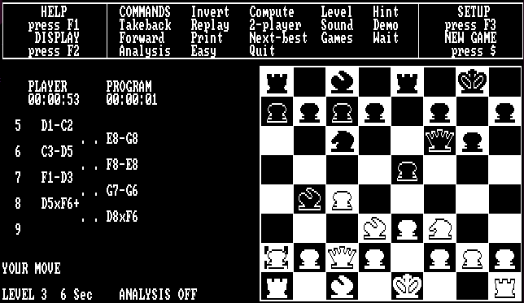

# Psion Chess as a UCI engine

  

Psion Chess (Richard Lang, 1985) is a DOS program. This project runs it in
a stripped-down, headless DOSBox and adds an adapter that speaks the UCI
protocol, so that it can be used from any chess GUI or match runner.

The adapter does not modify the chess program. It reads the game from the
emulated machine's memory and plays moves by pressing keys, as a user would.

Psion Chess is currently playing online at Lichess as
[psion-chess](https://lichess.org/@/psion-chess). It can be challenged at
[https://lichess.org/?user=psion-chess#friend](https://lichess.org/?user=psion-chess#friend)
(no account needed). Alternatively you can observe it playing at
[https://lichess.org/@/psion-chess/tv](https://lichess.org/@/psion-chess/tv).

## Running

### Quick start

Download a [prebuilt executable](#prebuilt-executables) or
[build](#building) one, and add Psion's files: `./psion -d` downloads, verifies and
installs them (see [data/README.md](data/README.md)). Then use `./psion`
(`psion.exe` on Windows) as the engine command in your GUI.

### Sample GUI engine dialog

    $ ./psion
    uci
    id name Psion Chess 1985
    id author Richard Lang
    option name Ponder type check default false
    option name Move Overhead type spin default 30 min 0 max 5000
    option name Cycles type string default highest
    option name UCI_LimitStrength type check default false
    option name UCI_Elo type spin default 1400 min 1150 max 1650
    uciok
    isready
    readyok
    position startpos moves e2e4
    go movetime 2000
    bestmove c7c5
    position startpos moves g2g4 a7a6 h2h4 h7h6
    go movetime 2000
    info depth 5 time 98 score cp -10 pv e2e4 d7d5 b1c3 g8f6 f2f3
    info depth 7 time 364 score cp -20 pv e2e4 d7d5 e4e5 d5d4 f1c4 b8c6 f2f4
    bestmove e2e4 ponder d7d5

### Command line options

- `-V`, `--verbose`: besides the UCI output, write diagnostics to stderr:
  the moves and board after each move, start-up messages, etc. The UCI
  command `debug on` does the same.
- `-c N`, `--cycles N`: run the emulated PC at a fixed speed of N
  instructions per millisecond instead of as fast as possible (see
  [Speed](#speed)), e.g. `--cycles 300` for roughly an original IBM PC,
  from start-up on; the `Cycles` option does the same from a GUI.
- `-d`, `--download`: download Psion Chess and install its files in the
  directory where the adapter looks for them (see
  [data/README.md](data/README.md)), after showing its copyright status
  and asking for confirmation. Needs `curl`, which Linux, macOS and
  Windows 10 and later normally have. The download is only installed if
  it is the known `psion213.zip`.
- `-v`, `--version`: print the version of the adapter, e.g. `Psion Chess
  UCI adapter v1.18`, and exit. Built from a commit after a release tag,
  the version also has the number of commits since the tag and the commit,
  e.g. `v1.18-5-g2d7a9cd`.
- `-h`, `--help`: list these options and exit.

### Supported UCI commands

`uci`, `isready`, `ucinewgame`, `position startpos|fen ... [moves ...]`, `go`
(`wtime`, `btime`, `winc`, `binc`, `movestogo`, `movetime`, `infinite`,
`ponder`), `ponderhit`, `stop`, `setoption`, `debug on|off` and `quit`.
How the engine handles the gray areas of the protocol is described under
[Quirks](docs/implementation.md#quirks).

### UCI options

- `Ponder`: for GUIs that only let an engine ponder if it offers it.
- `Move Overhead` (ms, default 30): the estimated time from telling
  Psion to move until the opponent has the move: Psion playing it and
  the adapter reporting it, plus sending it to the opponent via the GUI
  or the network. How this option is used is explained in more detail
  in the [Time allocation](#time-allocation) section below. The default
  of 30 ms covers the engine's own part, measured on an unloaded
  i5-1135G7. Increase `Move Overhead` if the engine loses on time, for
  example when playing fast games over a slow network.
- `Cycles` (default `highest`): the speed of the emulated PC, `highest`
  for as fast as the host allows (`max` is also accepted, but GUIs do not
  show it as the default, since `max` is a keyword in UCI's option line)
  or a fixed number of instructions per millisecond, e.g. `300` for roughly an original IBM PC (see
  [Speed](#speed)); at most 1,000,000. Values above what the host can do
  give its full speed. The speed applies only while Psion searches:
  setting up the position and entering moves run at full speed, so a
  move costs about as much time as at full speed (40 to 75 ms, against
  about 30 ms, on an i5-1135G7).
- `UCI_LimitStrength` (default false) and `UCI_Elo` (1150 to 1650,
  default 1400): play at a given strength on the CCRL Blitz scale, by
  running the emulated PC at reduced speed. This overrides `Cycles`;
  switched off, the `Cycles` speed applies again. The scale was measured
  at 2'+1"; at other time controls the strength differs somewhat. A host
  too slow for the speed asked for plays weaker.

### Environment variables

| Variable | Effect |
|---|---|
| `PSION_DIR` | Directory with Psion's files. |
| `PSION_ZIP_URL` | Where `-d` gets `psion213.zip`, e.g. a `file://` URL (CI uses its cached copy). |

### Limitations

- `go depth`/`nodes`/`mate` are not supported; these result in a fallback
  search of 5 s.
- Chess960 is not supported.
- The move counters of a FEN are ignored, so Psion's 50-move rule counts
  from the FEN (the GUI should still apply the rule itself).
- Limitations of `info` lines:
  - There is no node count.
  - The depth given is the length of the longest principal variation so
    far in the search, as Psion does not show its search depth.
  - The score has a resolution of 10 centipawns.
  - The number of moves to a mate is derived from the length of the
    principal variation.
  - Book moves and moves found instantly come without `info`.
- Psion searches to a fixed maximum depth and moves as soon as it is
  reached, whatever the time left. In a locked pawn ending, with few moves
  per ply, this takes under a second, so Psion moves almost at once even at
  long time controls (in Fine's position 70 it moves after about 1 second
  with 10 seconds to think). The depth limit is part of Psion's program and
  is left as it is.
- The move to ponder on (`bestmove ... ponder ...`) is the second move of
  Psion's principal variation, so there is none after a book move or a
  move found at once. A ponder miss costs about 0.05 seconds of the
  engine's clock.
- Entering the opponent's move and reporting the engine's take about
  70 ms per move on an i5-1135G7. This time is taken from the engine's
  own clock, so very fast time controls leave little time for thinking
  (see [Time allocation](#time-allocation)).
- Psion ends the game itself at a threefold repetition (and by the
  fifty-move rule) and then refuses to play on. A GUI that continues
  after a threefold repetition gets `bestmove 0000`, after `info string
  Game over (Psion shows DRAW)` (see [Quirks](docs/implementation.md#quirks)).
- Psion does not recognise insufficient material: it plays on with bare
  kings, and scores a lone bishop or knight against a bare king as about
  three pawns up. GUIs end such games themselves.

### Speed

The emulated PC runs as fast as the host allows (DOSBox's `cycles=max`).
On an Intel Core i5-1135G7 this is about 187,000 cycles per millisecond
during a search, i.e. roughly 190 million 8086 instructions per second;
an original IBM PC (8088, 4.77 MHz) managed about 0.3 million.

For comparison, Richard Lang's program won the 1987 World Microcomputer
Chess Championship on a 68020 at 12 MHz, about 2 million instructions
per second, so the engine runs some 60 to 120 times faster. This is only
a rough figure: the 1987 program was the 68000-family version, not this
8086 one, and a 68020 instruction (32-bit) does more work than an 8086
one (16-bit, segmented memory), so the real advantage is somewhat
smaller. At about 90 times the speed, a second here is worth a minute
and a half then: in a 3+2 blitz game (about 6 seconds a move) the engine
effectively thinks longer than at a tournament rate of 40 moves in 2
hours (3 minutes a move).

### Time allocation

A move gets the time given by `go movetime`, or else

    min(1/n * remaining_time + 3/4 * increment, 3/4 * remaining_time)

where `n` is `movestogo` if given, otherwise 30 with an increment and 60
without. `Move Overhead` is subtracted from this, and so is the time still
needed after `go` to set up the position, up to 200 ms. Psion always
thinks for at least 50 ms, so a move takes at least about 80 ms. Increase
`Move Overhead` if the engine loses on time. The details are in [Time
management](docs/implementation.md#time-management).

### Strength

Psion rates about 1700 on the CCRL Blitz scale, and gains about 60 Elo
from pondering. The matches and rating lists are in
[docs/strength.md](docs/strength.md).

### Implementation

How the adapter reads Psion's memory and screen, controls it with
simulated keypresses and manages the time, and the tools for experiments,
are described in [docs/implementation.md](docs/implementation.md).

### Diagnostic mode

Started with `--verbose` and without the `uci` command, the program
reads moves like `e2e4` from stdin and Psion replies to them; the
diagnostics (the moves and the board after each move) then go to
stdout. Moves typed while Psion thinks are played once it has moved;
`quit` ends the program at once.

## Building

Requirements: Linux on x86-64, g++ and GNU make. No other libraries.

Psion Chess itself is not included: see [data/README.md](data/README.md)
for where to download it.

    make            # builds ./psion
    make check      # unit tests (a second)
    make integration  # UCI tests against ./psion (about two minutes)

### Windows

The Windows version is cross-compiled on Linux with MinGW-w64 (package
`g++-mingw-w64-i686` on Debian/Ubuntu). It is a 32-bit executable, which
also runs on 64-bit Windows: the 64-bit recompiler of this DOSBox version
only supports the Linux calling convention.

    make windows                       # builds ./psion.exe
    make check TARGET=windows          # unit tests, under Wine
    make integration TARGET=windows    # UCI tests, under Wine

The tests need Wine with 32-bit support (`wine32:i386`). If Wine was
installed without it at first, its existing prefix (`~/.wine`) cannot run
32-bit programs; use a new one, e.g. `export WINEPREFIX=~/.wine32`.

### Prebuilt executables

Released versions can be downloaded from the repository's [*Releases*
page](https://github.com/vdbergh/psion-chess/releases). In addition, every
push is built by GitHub Actions: the packages are on the run's page under
*Actions*, *Artifacts* (for 90 days, and only when logged in to GitHub).

- `psion-chess-linux-x86_64`: a statically linked executable that runs on
  any x86-64 Linux.
- `psion-chess-windows-x86`: `psion.exe` for Windows. The integration tests
  pass with it under Wine and, in GitHub Actions, on Windows Server 2022
  and 2025.

Unpack the package and add Psion's files to its `data/` directory.

## Licence

The emulator is DOSBox (GPL, see `COPYING` and `AUTHORS`), reduced to
what Psion needs. Psion Chess itself is copyrighted by its authors; it is
not part of this repository and not covered by that licence.

Richard Lang wrote the chess engine of Psion Chess and kept its
copyright; the graphics and input/output were written by Psion. In
October 2026 he gave permission for his part to be freely distributable.
Psion's part needs permission from its rights holder. Zebra Technologies,
Psion's successor, could not confirm in October 2026 whether it still
holds these rights, and the current owner of the PSION trademark does
not hold them. So Psion Chess is still not included here.

PSION is a trademark of its owner. This project is not affiliated with,
endorsed by or sponsored by the owner of the PSION trademark or by
Psion's successors; the name is used only to identify the original 1985
program it runs.
