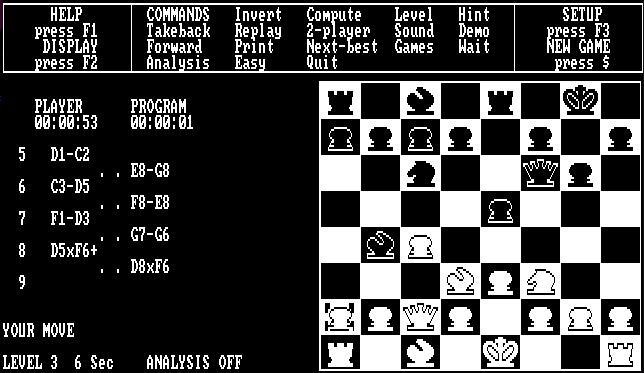

# Psion Chess as a UCI engine

  

Psion Chess (Richard Lang, 1985) is a DOS program. This project runs it in
a stripped-down, headless DOSBox and adds an adapter that speaks the UCI
protocol, so that it can be used from any chess GUI or match runner.

The adapter does not modify the chess program. It reads the game from the
emulated machine's memory and plays moves by pressing keys, as a user would.

## Building

Requirements: Linux on x86-64, g++ and GNU make. No other libraries.

Psion Chess itself is not included: see [data/README.md](data/README.md)
for where to download it.

    make            # builds ./psion
    make check      # unit tests (a second)
    make integration  # UCI tests against ./psion (about two minutes)

### Windows

The Windows version is cross-compiled on Linux with MinGW-w64 (package
`g++-mingw-w64-i686` on Debian/Ubuntu). It is a 32-bit executable, which
also runs on 64-bit Windows: the 64-bit recompiler of this DOSBox version
only supports the Linux calling convention.

    make windows                       # builds ./psion.exe
    make check TARGET=windows          # unit tests, under Wine
    make integration TARGET=windows    # UCI tests, under Wine

The tests need Wine with 32-bit support (`wine32:i386`). If Wine was
installed without it at first, its existing prefix (`~/.wine`) cannot run
32-bit programs; use a new one, e.g. `export WINEPREFIX=~/.wine32`.

### Prebuilt executables

Released versions can be downloaded from the repository's *Releases*
page. In addition, every push is built by GitHub Actions: the packages are
on the run's page under *Actions*, *Artifacts* (for 90 days, and only when
logged in to GitHub).

- `psion-chess-linux-x86_64`: a statically linked executable that runs on
  any x86-64 Linux.
- `psion-chess-windows-x86`: `psion.exe` for Windows. The integration tests
  pass with it under Wine; on Windows itself, GitHub Actions only checks
  that it starts (Psion's files are not available there).

Unpack the package and add Psion's files to its `data/` directory.

To make a release, push a version tag, e.g.
`git tag v1.0 && git push origin v1.0`.

## Running

Use `./psion` (`psion.exe` on Windows) as the engine command in your GUI.
Psion's files are read from `data/` next to the executable; set `PSION_DIR`
to use another directory. Without them the engine reports where it looked
and exits.

    $ ./psion
    uci
    id name Psion Chess 1985
    id author Richard Lang
    uciok
    isready
    readyok
    position startpos moves e2e4
    go movetime 2000
    bestmove c7c5
    position startpos moves g2g4 a7a6 h2h4 h7h6
    go movetime 2000
    info depth 5 time 87 score cp -40 pv g1f3 g8f6 d2d4 f6g4 e2e4
    info depth 5 time 104 score cp 10 pv e2e4 d7d5 b1c3 d5e4 c3e4
    bestmove e2e4

Only UCI output is written by default. With `--verbose` (or `-v`), or
after the UCI command `debug on`, the engine also writes diagnostics to
stderr: the moves and board after each move, start-up messages, etc.

`--cycles N` runs the emulated PC at a fixed speed of N instructions per
millisecond instead of as fast as possible (see [Speed](#speed)), e.g.
`--cycles 300` for roughly an original IBM PC, from start-up on; the
`Cycles` option does the same from a GUI.

### Supported UCI commands

`uci`, `isready`, `ucinewgame`, `position startpos|fen ... [moves ...]`, `go`
(`wtime`, `btime`, `winc`, `binc`, `movestogo`, `movetime`, `infinite`,
`ponder`), `ponderhit`, `stop`, `setoption`, `debug on|off` and `quit`.

Options:

- `Ponder`: for GUIs that only let an engine ponder if it offers it.
- `Move Overhead` (ms, default 94): what a move costs on the clock besides
  Psion's thinking: entering it, the GUI, the network. The default is the
  median with lichess-bot on a PC in Belgium. Increase it if the engine
  loses on time, e.g. with a slow connection to the server.
- `Cycles` (default `max`): the speed of the emulated PC, `max` for as
  fast as the host allows or a fixed number of instructions per
  millisecond, e.g. `300` for roughly an original IBM PC (see
  [Speed](#speed)); at most 1,000,000. Values above what the host can do
  give its full speed. Entering moves and reading Psion's reply slow down
  as well: at 300 a move costs about 4 seconds besides thinking, so
  increase `Move Overhead` with low values.

With a clock Psion thinks for 1/30 of the remaining time plus 3/4 of the
increment, or for 1/60 of the remaining time without an increment (with
`movestogo`: 1/movestogo), minus the move overhead, and at least 50 ms. In
sudden death the fixed cost of a move would otherwise make long games end
on time.

### Limitations

- FEN positions are set up with Psion's set-up mode (see below). Castling
  rights are kept: Psion treats a king or rook typed in set-up mode as
  moved, so those with rights are left where they stand in the start
  position. Castling rights whose king or rook is not on its square are
  ignored, and Chess960 rights are not supported. An en passant capture
  is possible: the position before the pawn's double step is set up, and
  the step is then played. The move counters of a FEN are ignored, so
  Psion's 50-move rule counts from the FEN (the GUI still applies the rule
  itself).
- `info` lines have the time searched (since Psion started to think, so
  without entering the opponent's move), a score and a principal
  variation, but no node count. Psion does not show the search depth
  either; the depth given is the length of the longest principal
  variation so far in the search. The score
  has a resolution of 10 centipawns. Book moves and moves found
  instantly come without `info`.
- A mate is shown by Psion as a score of 99.9; the number of moves to mate
  is derived from the length of the principal variation.
- `go depth`/`nodes`/`mate` are not supported; such searches take 5 seconds.
- Psion searches to a fixed maximum depth and moves as soon as it is
  reached, whatever the time left. In a locked pawn ending, with few moves
  per ply, this takes under a second, so Psion moves almost at once even at
  long time controls (in Fine's position 70 it moves after about 1 second
  with 10 seconds to think). The depth limit is part of Psion's program and
  is left as it is.
- Pondering is done by the adapter, not with Psion's own pondering (see
  easy mode below): after `go ponder` the move to ponder on is entered and
  Psion searches as for `go infinite`; after `ponderhit` the time for the
  move counts from then on, while Psion goes on with its search. After
  `stop` (the opponent played another move) the adapter takes back that
  move and Psion's reply, which costs about 0.05 seconds of the engine's
  clock. The move to ponder on (`bestmove ... ponder ...`) is
  the second move of Psion's principal variation, so there is none after
  a book move or a move found at once. While pondering, the engine uses
  a CPU core all the time.
- Entering the opponent's move and reporting the engine's take about 0.1
  seconds per move. This time is taken from the engine's own clock, so
  very fast time controls leave little time for thinking. (A GUI that
  sends `isready` before `go`, like fastchess, starts the clock after the
  opponent's move has been entered.)
- After `ucinewgame`, or when the GUI's move list diverges by more than four
  plies, the game is replayed from the start (about 0.13 s per ply).
- Psion applies its own draw rules and may announce a draw (e.g. by
  repetition) that the GUI does not see. Psion then stops accepting moves,
  so if the GUI continues the game, it is replayed in a new game.

### Speed

The emulated PC runs as fast as the host allows (DOSBox's `cycles=max`).
On an Intel Core i5-1135G7 this is about 187,000 cycles per millisecond
during a search, i.e. roughly 190 million 8086 instructions per second;
an original IBM PC (8088, 4.77 MHz) managed about 0.3 million.

For comparison, Richard Lang's program won the 1987 World Microcomputer
Chess Championship on a 68020 at 12 MHz, about 2 million instructions
per second, so the engine runs some 60 to 120 times faster. This is only
a rough figure: the 1987 program was the 68000-family version, not this
8086 one, and a 68020 instruction (32-bit) does more work than an 8086
one (16-bit, segmented memory), so the real advantage is somewhat
smaller. At about 90 times the speed, a second here is worth a minute
and a half then: in a 3+2 blitz game (about 6 seconds a move) the engine
effectively thinks longer than at a tournament rate of 40 moves in 2
hours (3 minutes a move).

### Strength

Matches with [fastchess](https://github.com/Disservin/fastchess), on the
i5-1135G7, with the balanced book `8moves_v3.pgn` (each opening played
with both colours); Elo with 95% confidence intervals, from the
pentanomial statistics.

| Match | Time control | Games | Result |
|---|---|---|---|
| Full speed against `--cycles 2000` (about 90 times slower) | 120+1.2 | 100 | +576 ± 192 Elo (94 wins, 1 loss, 5 draws) |
| Full speed against `--cycles 48000` (about 3.6 times slower) | 120+1.2 | 300 | +170 ± 35 Elo |
| Against micro-Max 4.8 (CCRL Blitz 1855) | 120+1 | 300 | −154 ± 38 Elo |
| Pondering against not pondering (book `UHO_4060_v4.epd`)\* | 30+0.3 | 100 | +70 ± 56 Elo |
| Pondering and not pondering, each against micro-Max 4.8\*\* | 30+0.3 | 400 | pondering −162 ± 50, not pondering −217 ± 48; difference +55 ± 57 Elo |

\* Not with fastchess, which does not support pondering, but through
python-chess, which sends `ponderhit` (or `stop` and the new position) as
lichess-bot does. 59% of the moves pondered on were played.

\*\* Also through python-chess. Both versions played the same 100
openings, each with both colours; the error of the difference is computed
from the differences per opening (the two versions' results correlate).
Against micro-Max, 48.5% of the moves pondered on were played.

- Psion gains about 90 Elo per doubling of the speed (1.83 doublings in
  the second match). So the engine is now some hundreds of Elo stronger
  than on the hardware of its time.
- Against micro-Max, Psion rates about 1700 on the CCRL Blitz scale. (Five
  of its 52 wins came from under-promotions to a knight, which micro-Max
  cannot represent: it resigns, also under WinBoard at CCRL. Without
  them the result would be about −167.) For comparison, the Swedish
  rating list (SSDF) has Psion on an 8 MHz Atari at 1791, a list once
  calibrated against human players; CCRL ratings are generally taken to
  be some hundreds of Elo below human ratings.
- Pondering gains about 55 to 70 Elo, about as much as 1.5 to 1.7 times
  the speed would (at 90 Elo per doubling); less against another engine,
  whose moves Psion predicts less often than its own. A move pondered on
  in vain costs about 0.05 seconds (the takebacks), which the time gained
  on the others more than makes up for.
- All these games in one rating list, computed with
  [Ordo](https://github.com/michiguel/Ordo) (errors are 95% intervals,
  relative to the anchor). The time controls are kept apart: Psion and
  micro-Max at 30+0.3 are other players than at 120+1. Both groups are
  anchored at micro-Max's CCRL Blitz rating of 1855, which CCRL measures
  at about 120+1, so for 30+0.3 this is only an approximation. Matches of
  identical engines are left out.

  | 120+1 (700 games) | Rating | Error |
  |---|---|---|
  | micro-Max 4.8 | 1855 | anchor |
  | Psion | 1699 | ± 38 |
  | Psion, 3.6 times slower | 1527 | ± 52 |
  | Psion, 90 times slower | 1117 | ± 163 |

  | 30+0.3 (500 games) | Rating | Error |
  |---|---|---|
  | micro-Max 4.8 | 1855 | anchor |
  | Psion, pondering | 1695 | ± 40 |
  | Psion | 1631 | ± 42 |

  In the second list the difference between pondering and not pondering
  is 64 ± 44 Elo (Ordo, from all 500 games, as independent games).
- Psion has no transposition table: during a search only about 4 KB of
  memory changes, in small areas such as move lists, and nothing that
  fills up as the search proceeds. Every search starts afresh, which
  costs it most in endgames. Compared with native engines it is also
  handicapped by the emulation: the emulated PC is much slower than a
  native program on the same machine.

## How it works

`src/psion_mods/` holds everything that is not DOSBox:

| File | Contents |
|---|---|
| `psionmain.cpp` | `main()` and the headless video, mapper and joystick stubs. |
| `psion.cpp` | Starting Psion, keyboard input, reading the game state, the UCI controller. |
| `chess.cpp` | Logic that does not depend on the emulator (move derivation, UCI parsing, time allocation, syncing). Unit tested. |
| `ocr.cpp` | Reading text and pieces from the screen. |
| `memscan.cpp` | A tool that locates Psion's board in memory (see below). |

The adapter never modifies Psion or its memory. It gets its data in two
ways:

- **The game** (board, side to move, ply) is read from Psion's memory.
  Moves are derived from changes of the board, not from the screen: memory
  is exact and changes even when the screen is not redrawn.
- **Everything else** is read from the screen: the level, the modes,
  prompts and the analysis display.

The rule: what must be exactly right to keep the game in sync comes from
memory; what is only checked, or shown to the user, may come from the
screen. The board on the screen proved unreliable for the game: the
cursor, highlighted squares and flashing kings cause misread squares,
and the screen shows neither the whole move list nor reliably whose
turn it is.

Psion is controlled only through simulated keypresses. The adapter checks
the effect of each key, in memory or on the screen, before it presses the
next one, and retries a few times if a key had no effect.

Psion keeps no node count, and its search depth is not found in memory
or on the screen. So `info` lines have no `nodes` or `nps`, the depth is
the length of the longest principal variation seen, and the time is
measured by the adapter itself.

### Psion's memory

These offsets are relative to Psion's data segment. The adapter locates
it once, while Psion shows the start position: it tries DS first, and
otherwise scans memory for the start position. The segment is not
searched again later, because other board-like data in memory could be
taken for the game.

| Offset | Contents |
|---|---|
| `28AC` | The board: 64 bytes, a8..h8, a7..h7, ..., a1..h1. |
| `725B` | Side to move: `00` White, `FF` Black. Unreliable while the engine searches its own move. |
| `7260` | Ply counter (word). While pondering it includes the predicted reply. After set-up mode it starts at 20 (21 with Black to move). |

Square codes: empty `00`, pawn `2C`, knight `24`, bishop `1C`, rook `0A`,
queen `17`, king `01`; bit `80` is set for Black and bits `40`/`04` are
flags that do not change the piece. Promoted pieces get codes that are not
known in advance (seen: `10` and `20`); the adapter learns them from the
piece it typed at the promotion prompt or from the screen. Bit `04` (and
`40`) marks a king or rook that has moved. Psion's own record of that
(whether it may castle) is elsewhere, e.g. in its piece list (from `5BC0`
for White); a king or rook typed in set-up mode is marked as moved there,
while the board at `28AC` still shows it as unmoved.

The adapter reads these every 10 ms. It accepts a memory state once it
has been unchanged for 200 ms (while Psion searches, memory changes much
more often) and derives each move from the change of the board. While
Psion searches its own move, the adapter counts the plies itself instead
of trusting the side-to-move byte. If no legal move explains a change,
it resynchronizes to the state in memory. Reads that fail are ignored:
Psion flashes the kings when it announces a draw or mate.

### The screen

DOSBox renders each screen update into a 640x400 frame, which
`ProcessScreen` hands to `ocr.cpp`. `ocr()` turns it into 80x25 text by
matching each 8x8 cell against Psion's font, and `ocr_board()` reads the
pieces off the graphical board. Each row keeps its last non-blank
contents, because some rows blink. The adapter uses:

| Row | Used for |
|---|---|
| 6 | `PLAYER PLAYER`: 2-player mode is on. |
| 22 | The status line: level 11 (`LEVEL 11  4 Min`), easy mode (`LEVEL E`), `ANALYSIS ON`. |
| 24 | The analysis display (see below), and the `PROMOTE TO` and `ILLEGAL` prompts. |

The board read from the screen is used only to identify promoted pieces
whose codes are unknown (see above), and as the reference for `memscan`.

### Controlling Psion

- Level: set to 11 (4 minutes per move) at start-up, so Psion moves
  when told to (`m`, below). Not *Infinite*: at that level Psion stops
  reading the keyboard once its search reaches the maximum depth, which
  happens almost at once in a locked pawn ending.
- `e` switches easy mode on: Psion does not think on the opponent's
  time. (Pondering, too, can hang in such positions.)
- `a` switches analysis mode on: while Psion thinks, the bottom row shows
  its score (in pawns, for the side to move) and principal variation,
  e.g. `-00.4 E2-E4 D7-D5 B1-C3 D5xE4`. These become `info` lines. A row
  is used once it has not changed for 50 ms (Psion erases the characters
  that change before drawing new ones) and if its moves are legal on the
  board (castling rights are not checked). Promotions are shown without
  the piece: the first of queen, knight, rook and bishop with which the
  rest of the line is legal is assumed.
- `2` sets 2-player mode, in which moves for both sides can be entered.
- `c` (Compute) starts a search, `m` (Move now) ends it when the time
  allocated to the move is used up.
- `t` takes back one ply, `$` starts a new game. Several plies are taken
  back with one `t` each, pressed at once; the position they lead to is
  accepted as soon as it is in memory.
- F3 enters and leaves set-up mode. For a FEN, the adapter starts a new
  game and enters set-up mode. Without castling rights it empties the
  board (`e`); with castling rights it keeps the start position, empties
  the squares that change (`0`) and types a rook again to remove its
  right. It moves the cursor to each square and types the piece, with `c`
  to change the colour, and leaves set-up mode with the side to move as
  the colour last set up. The kings come last, so that the board in
  memory is not taken for a position before it is complete. A new game
  first, for the start position, and because entered with Black to move,
  Psion leaves set-up mode with an invalid side to move.
- Moves are entered by moving the cursor; F3 F3 (into and out of set-up
  mode) resets it to a known square.
- While Psion waits for the GUI, the emulation is stopped until the next
  command arrives, so an idle engine uses no CPU (unless it ponders).
  This starts once Psion has been idle for a moment, so that it has
  finished drawing the screen. Psion's own clock stands still meanwhile,
  which does not matter: the adapter keeps the time.

## Other modes and tools

Without the `uci` command the program reads moves like `e2e4` from stdin,
and Psion replies to them; diagnostics then go to stdout. Environment variables for experiments:

| Variable | Effect |
|---|---|
| `PSION_DIR` | Directory with Psion's files. |
| `PSION_TWOPLAYER` | Stay in 2-player mode: moves for both sides from stdin. |
| `PSION_MEMSCAN` | Locate the board in memory by correlating memory snapshots with the board on screen. |
| `PSION_MEMDUMP` | Directory to write memory snapshots to (with `PSION_MEMSCAN`). |

`tools/find_state.py` searches such snapshots for side-to-move flags and
counters; `tools/match.py` plays two engines against each other;
`tools/lichess_check.py` checks the engine with python-chess, the way
lichess-bot uses it.

## Licence

The emulator is DOSBox (GPL, see `COPYING` and `AUTHORS`), reduced to
what Psion needs. Psion Chess itself is copyrighted by its authors; it is
not part of this repository and not covered by that licence.
